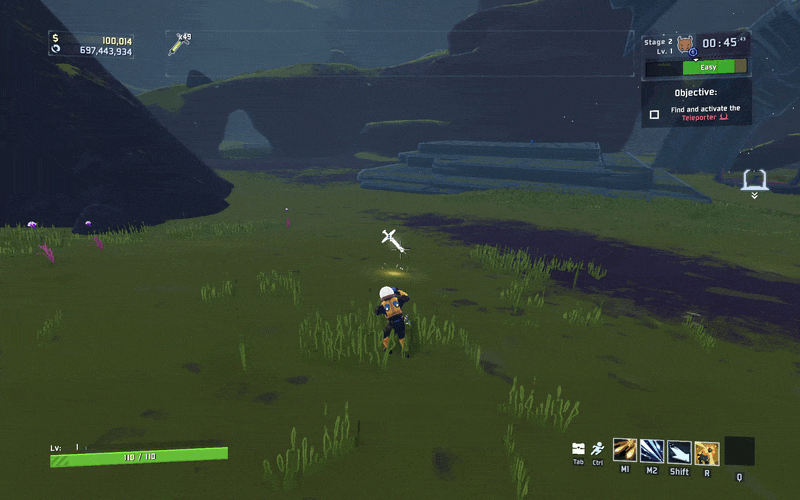
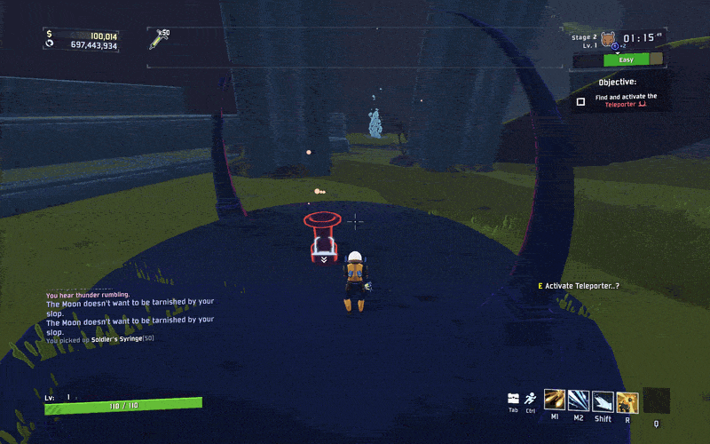

# mithrixslop .,.,

mithrix hates slop and will double karma because he hates slop and doesnt like you with slop ,.,. can only lower multiplier by less than 2 if no ai gen mods are installed ,.,, karma triggers past 8 will also add a + next to your karma with the ones past 8 .,,.,.

should be networked hopefully maybe ?/,..,

## effects past k8 .,.,
- pillar of mass that lands on you ,.., locks teleporter ,.,. base 20% + 5% per karma past k8 ,.,
- on death perfected enemies / normal enemies on 2% chance per karma past k8 spawn mithrix fissures ,.,.,.
- 15% (+5% per karma past k8( of bosses will spawn lunar chimeras alongside them .,.,
- 2% (+2% per karma past k8( of enemies will spawn as perfected ,..,
- 3% (+3% per karma past k8( of enemies will spawn alongside a lunar chimera ,..,

### credits ,.,.,.
- smxres ,., perfected elite spawn idea .,,.
- borbo .,., pillar of mass killing  you .,.,,.
- vcr ,.., spawn chimeras alongside enemies .,,.
- dommi (famous animator ,.., from starstorm 2(.,., original past karma 8 idea .,.,
- acanthi ,.,. being lovely :plead: .,,.,.
